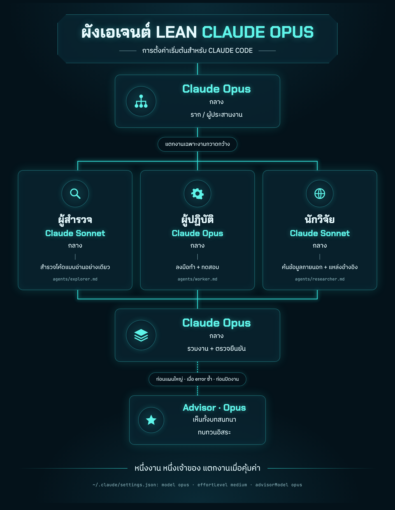

# Claude Lean

A token-safe Claude Code setup: one Opus coordinator, cheaper Sonnet subagents for wide sweeps and code review, an Opus worker for building, and the Opus advisor for plans. `/ship` runs a feature through spec, build and review.



The source of the infographic is [docs/infographic.html](docs/infographic.html).

## How it works

| Role | Model | Effort | Job |
|---|---|---|---|
| Root / coordinator | Opus | medium | Plans, delegates only wide sweeps, integrates and verifies |
| `explorer` | Sonnet | medium | Read-only code search, returns `file:line` summaries |
| `worker` | Opus | medium | Implements one bounded task and runs its tests; reports `STATUS: READY` or `BLOCKED` |
| `reviewer` | Sonnet | medium | Read-only review of a change; reports `VERDICT: PASS` or `CHANGES` with `path:line` findings |
| `researcher` | Sonnet | medium | Outside docs, APIs and versions, with sources |
| Advisor | Opus | n/a | Independent review before a big plan and on a repeated error |

One task, one owner. Delegate only when it pays off: each subagent starts cold, so a few direct greps in the main session are cheaper than spawning one for a narrow lookup.

## Shipping a feature

Type `/ship <feature>` in a repo with a clean working tree:

```
spec (coordinator) -> you approve -> worker builds on ship/<job-id> -> reviewer
                                         ^                              |
                                         +--- CHANGES (max 2 resumes) --+
                                                                        v PASS
                                         gate: READY or ESCALATE -> branch ready (or merged with --merge)
```

- The coordinator writes `spec.md` with acceptance criteria and waits for your approval before any code is written.
- The worker builds and tests on a `ship/<job-id>` branch. The reviewer checks the diff against the spec. On `CHANGES` the same worker is resumed, at most twice.
- The worker records evidence for every acceptance criterion in `build.md`; the reviewer re-runs at least one. At the gate, the coordinator checks that evidence, re-runs one criterion itself, and checks the branch merges cleanly with `git merge-tree`.
- The gate escalates changes to payments, auth, secrets, deploy or CI config, schemas, production data or dependencies. Otherwise the branch is ready to merge; `--merge` merges it into your branch. It never pushes.
- Job files live in `.lean/jobs/<job-id>/`, which `/ship` adds to `.git/info/exclude`, so they are never committed.
- Agents read build, test and lint commands from the repo's `CLAUDE.md` or `AGENTS.md`, so make sure those are written down.
- Only you can start `/ship`; Claude never runs it on its own (`disable-model-invocation`). Check its resident cost with `/context` after installing.

## What's included

```
claude/
  CLAUDE.md            global rules: plan, verify, subagent limits, token safety
  settings.json        model, effortLevel, advisorModel
  agents/
    explorer.md
    researcher.md
    worker.md
    reviewer.md
  skills/
    ship/SKILL.md      /ship: spec, build, review, gate
docs/
  infographic.html
  infographic.png
install.sh
```

## Install

```bash
git clone <this repo> claude-lean
cd claude-lean
./install.sh
```

`install.sh` copies the files into `~/.claude` and backs up anything it changes to `~/.claude/backup-<timestamp>/`. Files that are already up to date are skipped, so running it again is safe. For `settings.json` it only adds `model`, `effortLevel` and `advisorModel`, and keeps all your other settings. If you already set one of those three, it keeps your value and tells you; run `./install.sh --force` to use the setup's values instead. If `settings.json` is not valid JSON, the installer stops before changing anything.

It replaces `~/.claude/CLAUDE.md`. If you had your own rules, merge them back from the backup folder.

To install into another folder, set `CLAUDE_HOME`:

```bash
CLAUDE_HOME=/path/to/.claude ./install.sh
```

### Manual install

Copy `claude/agents/*.md` into `~/.claude/agents/` and `claude/skills/ship/` into `~/.claude/skills/ship/`, add the rules from `claude/CLAUDE.md` to `~/.claude/CLAUDE.md`, and add the three keys from `claude/settings.json` to `~/.claude/settings.json`.

### One project only

Put the same files in a repo instead of your home folder: `.claude/agents/`, `.claude/skills/`, `CLAUDE.md` at the repo root, and `.claude/settings.json`. Everyone who works in that repo gets the setup.

## Tips

- Start a new session after installing. Settings and rules are read at startup.
- Effort is `medium` by default. Type `/effort high` in a session for a hard task.
- The advisor sends the whole conversation to Opus on each call, so keep it to the two moments above. Use the `reviewer` to check finished code.
